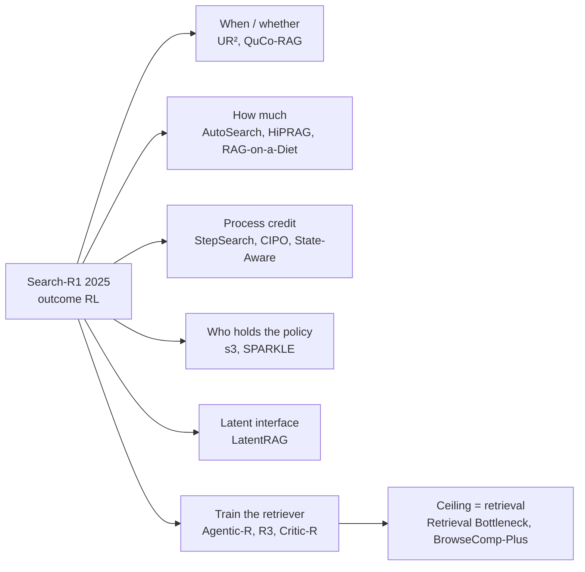

# 4. Learned retrieval policies: RL for search (2025 → 2026)

> **Code:** [`code/ragkit/agentic.py`](../code/ragkit/agentic.py) (the rollout protocol), [`autosearch_reward.py`](../code/ragkit/autosearch_reward.py), [`quco.py`](../code/ragkit/quco.py). **Reproduce:** [experiments/](../experiments/).

This is the core of the thesis. It is where "when, what and how much to retrieve" stop being hyperparameters and become a **policy**.

## 4.1 The bridge: Search-R1 (2025)

Read [papers/2025/search-r1.md](../papers/2025/search-r1.md). The essentials:

```
<think> … </think> <search> q </search> <information> docs </information> … <answer> a </answer>
reward = EM(a, gold)          # outcome only
loss mask: tokens inside <information> are not trained on
RL: PPO or GRPO (verl), Qwen2.5-3B/7B, E5 over Wikipedia-2018
```

Why it matters:
1. The policy learns *when* and *what* to search with no retrieval labels.
2. It showed that the DeepSeek-R1 recipe transfers to tool use.
3. It fixed a de-facto benchmark protocol (7 QA sets, EM) that everyone after it reuses, for better and worse.

The 2025 wave (R1-Searcher, ReSearch, ZeroSearch, s3, DeepResearcher, WebThinker) varies the environment, the reward and which component is trained. See the [2025 catalogue](../papers/2025/README.md).

### GRPO in one paragraph
Group Relative Policy Optimization (from DeepSeekMath, [arXiv:2402.03300](https://arxiv.org/abs/2402.03300)) samples a *group* of G rollouts per question and uses each rollout's reward minus the group mean, divided by the group standard deviation, as its advantage. No value network is needed. It is cheaper than PPO and popular for search agents, but it can be less stable with sparse rewards, which is why many search papers still report PPO.

## 4.2 2026: four directions on top of Search-R1

### (a) *Whether* retrieval helps: UR² (ACL 2026 main)
Deep-dive: [papers/2026/ur2.md](../papers/2026/ur2.md)
- **Problem:** outside open-domain QA (math, MMLU-Pro, medicine), RL search agents over-rely on retrieval or abandon it.
- **Idea:** a difficulty-aware curriculum (retrieve only for hard items) plus LLM-summarised evidence, and two-stage RL (first reward using retrieval, then reward correctness).
- **Result:** 3B–8B models match GPT-4o-mini and GPT-4.1-mini on several benchmarks.

### (b) *How much* to retrieve: AutoSearch (Findings ACL 2026)
Deep-dive: [papers/2026/autosearch.md](../papers/2026/autosearch.md)
- **Problem:** over-searching.
- **Idea:** self-answer after each search. The first correct step t_c is the minimal sufficient depth. Reward stopping at t_c and penalise steps beyond it.
- **Result:** higher EM *and* fewer searches than Search-R1 and StepSearch (7B: 48.0 EM at depth 1.27, vs 40.0 at 2.08).

### (c) *When* to retrieve, without the model's opinion: QuCo-RAG (Findings ACL 2026)
Deep-dive: [papers/2026/quco-rag.md](../papers/2026/quco-rag.md)
- Not RL, but it answers the same "when" question from a different angle: **pre-training-corpus statistics** instead of model confidence.
- Rare entity → retrieve. Zero co-occurrence of a generated (head, tail) pair → retrieve.
- **Result:** +5–12 EM over FLARE, DRAGIN and SeaKR on OLMo-2, with no training.

### (d) *Who* holds the policy: SPARKLE (ACL 2026 main)
Note: [papers/2026/sparkle.md](../papers/2026/sparkle.md)
- Train a **3B proxy** with PPO to control retrieval for a *frozen* LLM and retriever, reasoning over KG-style triplet chains.
- It transfers to other LLMs and retrievers without retraining. Related to s3 (2025) and State-Aware RAG (§6), which also train only a small component.

### (e) Process rewards: crediting the *steps*, not only the answer
Outcome-only reward gives the same credit to a 4-search and a 5-search trajectory with the same answer (run `python code/examples/06_grpo.py`). The 2025–26 fixes:

| Method | Step-level signal | Note |
|---|---|---|
| **StepSearch** (2025) | information gain minus redundancy, per search step (step-wise PPO) | needs sub-question-level trajectories |
| **R3-RAG** (2025) | relevance-based document verification as a process reward | cold-start SFT, then RL |
| **ReARTeR** (2025) | a trustworthy process reward model + a process *explanation* model | MCTS-collected preferences |
| **AutoSearch** (Findings 2026) | marginal F1 gain per step + depth-based efficiency | [note](../papers/2026/autosearch.md) |
| **HiPRAG** (ICLR 2026) | was *this* search (or non-search) decision necessary? | over-search rate 2.3%; [note](../papers/2026/hiprag.md) |
| **CIPO** (arXiv 2026) | turn-level credit for reasoning actions actually *influenced by* retrieved evidence | targets prior-driven confirmation bias |
| **AgenticRag-R1** (arXiv 2026) | hierarchical action-aware rewards over reason / retrieve / memorise actions with a memory stack | long-horizon |
| **State-Aware RAG** (Findings 2026) | LLM-judge path reward on memory quality | [note](../papers/2026/state-aware-rag.md) |

### (f) Exploration
RL search policies get stuck in confidently wrong "dead ends". **REX-RAG** (2025) mixes probe sampling with exploratory prompts and corrects the distribution shift with importance sampling. **SPARKLE** uses binary tree-structured rollouts.

### (g) Train the retriever too
**Agentic-R** (Findings 2026), **R3** (2025) and **Critic-R** (2026) optimise the *retriever* for the agent's sub-queries. See [18](18-retrievers-for-reasoning-and-agents.md).

## 4.3 Cost-aware policies

- **RAG-on-a-Diet** (ACL 2026 main): an RL agent picks the **model size per hop** (4B / 30B / 671B). 60% cheaper than IRCoT for a 3.7% F1 drop on HotpotQA. [note](../papers/2026/rag-on-a-diet.md)
- **AutoSearch** reduces the number of hops; **RAG-on-a-Diet** reduces the cost of each hop. Together they suggest a two-dimensional budget: depth × model size.

## 4.4 The "so what": The Retrieval Bottleneck (ACL 2026 main)

[note](../papers/2026/retrieval-bottleneck.md): RL-for-RAG performance follows sigmoidal scaling in compute, and **the ceiling is set by retrieval quality**. Algorithm and reward choices mostly change how *fast* you approach it. This matches State-Aware RAG's +22.2% from switching Wikipedia for Google Search.

**Takeaway for practitioners:** fix the retriever and corpus before tuning the RL algorithm.

Four independent 2026 data points agree:

| Evidence | Retrieval change | Effect |
|---|---|---|
| The Retrieval Bottleneck (ACL 2026) | retriever quality in RL scaling curves | sets the asymptote |
| State-Aware RAG (Findings 2026) | Wikipedia → Google Search | +22.2% |
| BrowseComp-Plus (ACL 2026) | GPT-5 with BM25 → Qwen3-Embedding-8B | 55.9% → 70.1%, *with fewer searches* |
| Legal RAG Bench (arXiv 2026) | best embedder vs. others | +17.5 correctness; many "hallucinations" were retrieval failures |



## 4.5 Reward design cheat-sheet

| Reward component | Used by | Risk |
|---|---|---|
| Outcome EM/F1 | Search-R1, most | sparse; no credit for good queries |
| Format | R1-Searcher, UR², AutoSearch | trivially maximised; keep it small |
| Retrieval-usage bonus | UR² (stage 1), R1-Searcher (stage 1) | reward hacking if left on |
| Step / information gain | StepSearch, AutoSearch (quality) | needs gold evidence or F1 |
| Depth / efficiency | AutoSearch | defined only when intermediate answers can be checked |
| Monetary cost | RAG-on-a-Diet | needs a price model |
| LLM-judge path reward | State-Aware RAG | expensive; judge bias |
| Gain Beyond RAG | s3 | needs a naive-RAG baseline per question |

## 4.6 Known weaknesses of this whole line
- **Benchmark saturation:** almost every paper trains on NQ + HotpotQA and tests on the same 7 short-answer QA sets.
- **Numbers don't compare across papers:** backbones, Base vs Instruct, retrievers, sample sizes and EM definitions all differ. See [11](11-evaluation.md).
- **Static Wikipedia** is not the web. DeepResearcher and WebThinker train on the live web; most 2026 papers do not.
- **Short answers only:** efficiency rewards like AutoSearch's rely on exact match of intermediate answers.

## Poll for the audience
*"Your company's RAG bot over internal docs is 70% accurate. You have one month. Do you (a) RL-train a search policy, (b) improve parsing, chunking and retrieval, or (c) upgrade the LLM?"* Discuss using The Retrieval Bottleneck and HiKEY.
