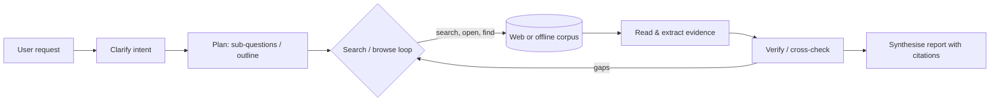

# 13. Deep research agents

**Deep research (DR)** extends agentic RAG from *answering a question* to *producing an analyst-grade, cited report*. The agent plans, runs dozens to hundreds of searches and page reads over minutes to hours, verifies, and synthesises. Products include OpenAI Deep Research, Gemini Deep Research and Claude Research. Open systems include Tongyi DeepResearch, WebThinker, DeepResearcher, MiroThinker and OpenResearcher.

## 13.1 How DR differs from agentic RAG

| | Agentic RAG (Search-R1 line) | Deep research |
|---|---|---|
| Output | short answer | long report with citations |
| Horizon | 1–5 searches | tens to hundreds of tool calls |
| Tools | `search` | `search`, `open`, `find`, browse, code, files |
| Environment | local Wikipedia | live web, or a large offline corpus |
| Reward / eval | EM / F1 | rubrics, checklists, citation checks, LLM judges |
| Main difficulty | when and what to search | planning, long-horizon credit assignment, verification, synthesis |

## 13.2 Training open DR agents

| System | Recipe | Link |
|---|---|---|
| **DeepResearcher** (2025) | end-to-end RL in the **real web** environment | [arXiv:2504.03160](https://arxiv.org/abs/2504.03160) |
| **WebThinker** (2025) | reasoning model + deep web explorer + report drafting during thinking | [arXiv:2504.21776](https://arxiv.org/abs/2504.21776) |
| **WebDancer** (2025) | four stages: browsing data → trajectory sampling → SFT cold start → RL | [arXiv:2505.22648](https://arxiv.org/abs/2505.22648) |
| **WebSailor** (2025) | high-uncertainty synthetic tasks (obfuscation) + RFT cold start + **DUPO** RL | [arXiv:2507.02592](https://arxiv.org/abs/2507.02592) |
| **MaskSearch** (2025) | *pre-train* agentic search with retrieval-augmented mask prediction | [arXiv:2505.20285](https://arxiv.org/abs/2505.20285) |
| **OpenResearcher** (2026) | fully **offline** 15M-document environment; 97K trajectories with 100+ tool calls; SFT reaches 54.8% on BrowseComp-Plus | [note](../papers/2026/openresearcher.md) |
| **DeepResearch-9K** (2026) | 9K questions at 3 difficulty levels + the **DeepResearch-R1** open RL framework (rule-based and LLM-judge rewards) | [arXiv:2603.01152](https://arxiv.org/abs/2603.01152) |
| **Tongyi DeepResearch** | open 30B-A3B DR model; agentic CPT + SFT + RL | [code](https://github.com/Alibaba-NLP/DeepResearch) |

**Survey:** *Reinforcement Learning Foundations for Deep Research Systems* ([arXiv:2509.06733](https://arxiv.org/abs/2509.06733)) organises the field by data synthesis, RL methods (stability, long context, reward and credit design, multi-objective trade-offs) and training systems. It argues that SFT and DPO are weak for long-horizon credit assignment. **Position paper:** *From Web Search towards Agentic Deep Research* ([arXiv:2506.18959](https://arxiv.org/abs/2506.18959)), with its companion list [DavidZWZ/Awesome-Deep-Research](https://github.com/DavidZWZ/Awesome-Deep-Research).

## 13.3 Evaluating DR

| Benchmark | What it measures | Notable finding |
|---|---|---|
| **BrowseComp** (OpenAI, 2025) | hard-to-find facts on the live web | proprietary DR agents far ahead of open ones in 2025 |
| **BrowseComp-Plus** (ACL 2026 main) | BrowseComp on a **fixed ~100K-document corpus**, so retriever and agent can be varied separately | Search-R1 + BM25: 3.86%; GPT-5: 55.9%; GPT-5 + Qwen3-Embedding-8B: **70.1% with fewer searches** ([note](../papers/2026/browsecomp-plus.md)) |
| **Deep Research Bench** (FutureSearch, 2025) | 89 multi-step web research tasks; frozen "RetroSearch" web | offline agents perform comparably to live-web agents ([arXiv:2506.06287](https://arxiv.org/abs/2506.06287)) |
| **ResearchRubrics** (2025) | 2,500+ expert rubrics for grounding, reasoning and clarity | leading DR agents under 68% rubric compliance ([arXiv:2511.07685](https://arxiv.org/abs/2511.07685)) |
| **FINDER + DEFT** (2025) | 100 tasks, 419 checklist items; **failure taxonomy** of 14 modes | agents struggle with *evidence integration, verification and resilient planning*, not with understanding the task ([arXiv:2512.01948](https://arxiv.org/abs/2512.01948)) |
| **MMDeepResearch-Bench** (2026) | 140 multimodal tasks; report quality, citation alignment, text–visual integrity | good prose ≠ faithful evidence use ([arXiv:2601.12346](https://arxiv.org/abs/2601.12346)) |
| **MiroEval** (2026) | 100 real-user tasks; evaluates the **process** as well as the output | process quality predicts the outcome; multimodal costs 3–10 points ([arXiv:2603.28407](https://arxiv.org/abs/2603.28407)) |
| **WebWalkerQA** (2025) | traversal of a website's subpages | [arXiv:2501.07572](https://arxiv.org/abs/2501.07572) |
| GAIA, xbench-DeepSearch | general assistant and deep-search tasks | used by OpenResearcher and WebDancer |

## 13.4 Lessons that carry over to "ordinary" RAG
1. **Retrieval still sets the ceiling.** BrowseComp-Plus shows a better retriever makes a frontier agent more accurate *and* cheaper.
2. **Offline environments make the science possible** (BrowseComp-Plus, OpenResearcher, RetroSearch): fixed corpora enable controlled ablations.
3. **Verification is the weak link**, according to FINDER/DEFT's failure taxonomy. Pair this with the trust methods in [08](08-evidence-and-trust.md).
4. **Evaluate the process, not only the report** (MiroEval).

## 13.5 Open problems
- Long-horizon **credit assignment** over 100+ tool calls.
- **Cost:** DR runs cost dollars, not cents. Efficiency methods from [10](10-efficiency.md) (AutoSearch-style stopping, caching) are largely untested at this horizon.
- **Citation faithfulness** at report scale.
- **Security:** a DR agent reads thousands of untrusted pages, which is the prompt-injection and poisoning surface in [15](15-security.md).
