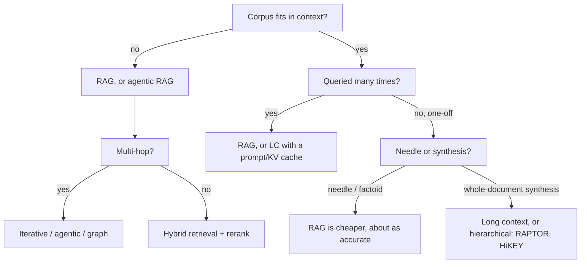

# 14. Long context vs. RAG, and context engineering

With 1M-token context windows, the recurring question is: *why not put everything in the prompt?* The evidence says **it depends**, and the best systems route between the two or combine them.

## 14.1 The evidence

| Study | Finding |
|---|---|
| **Self-Route** (Li et al., EMNLP 2024 industry; [arXiv:2407.16833](https://arxiv.org/abs/2407.16833)) | With enough resources, **long context (LC) beats RAG on average**, but RAG is far cheaper. *Self-Route* lets the model decide per query (answerable from retrieved chunks? if not, go LC). It is close to LC quality at much lower cost. |
| **OP-RAG** (Yu et al., 2024; [arXiv:2409.01666](https://arxiv.org/abs/2409.01666)) | "In defense of RAG": keep retrieved chunks in their **original document order**. Quality over the number of chunks is an **inverted U**, and the sweet spot beats feeding the whole context with far fewer tokens. |
| **LongRAG** (Jiang et al., 2024; [arXiv:2406.15319](https://arxiv.org/abs/2406.15319)) | Use **4K-token retrieval units** instead of 100 words: a "long retriever" plus a "long reader". NQ 62.7 EM and HotpotQA 64.3 EM with no training. |
| **Long-context LLMs meet RAG** (Jin et al., ICLR 2025; [arXiv:2410.05983](https://arxiv.org/abs/2410.05983)) | More retrieved passages first help, then **hurt** (hard negatives). Fixes: retrieval reordering and RAG-specific fine-tuning. |
| **LaRA** (Li et al., 2025; [arXiv:2502.09977](https://arxiv.org/abs/2502.09977), 💻 [Alibaba-NLP/LaRA](https://github.com/Alibaba-NLP/LaRA)) | 2,326 test cases, 11 LLMs: **no silver bullet**. The best choice depends on model size, long-context ability, context length, task type and chunk characteristics. |
| **Lost in the Middle** (TACL 2024) | Position matters even when everything fits. |

## 14.2 A decision guide

Rules of thumb:
- **Cost scales with tokens read.** LC re-reads everything per query unless you cache it. RAG reads a few thousand tokens.
- **Freshness and access control** favour RAG. Permissions are applied at retrieval time.
- **Attribution** favours RAG: citations point to specific chunks.
- **Holistic questions over one long document** favour LC or hierarchical retrieval.

## 14.3 Context engineering

"Context engineering" treats *everything* in the context window as an optimisation target: instructions, retrieved evidence, memory, tool outputs, conversation state. The **survey** by Mei et al. ([arXiv:2507.13334](https://arxiv.org/abs/2507.13334), 1,400+ papers) decomposes it into **context retrieval and generation → context processing → context management**, and treats RAG, memory systems, tool-integrated reasoning and multi-agent systems as implementations. It notes an asymmetry: models understand complex contexts far better than they generate equally complex long-form outputs.

Techniques in this repo that are context engineering:
| Technique | Where |
|---|---|
| Reranking, MMR, position-aware ordering | [01](01-foundations.md), [`rerank.py`](../code/ragkit/rerank.py) |
| Compression (RECOMP, LongLLMLingua), LLM summaries (UR²) | [03](03-classic-advanced-rag.md), [UR²](../papers/2026/ur2.md) |
| Working-memory curation (State-Aware RAG), memory stacks (AgenticRag-R1) | [06](06-memory-and-state.md) |
| Budgeted, structure-aware packing (HiKEY) | [07](07-knowledge-representation.md) |
| Triplet state instead of free-text reasoning (T²RAG) | [07](07-knowledge-representation.md) |
| Latent context (LatentRAG, CLaRa) | [05](05-latent-retrieval.md) |

## 14.4 Hybrid patterns
1. **Route** per query: Self-Route, Adaptive-RAG ([`router.py`](../code/ragkit/router.py)).
2. **Retrieve big units, read long** (LongRAG).
3. **Retrieve, then expand to the parent section** (HiKEY's sibling units; small-to-big retrieval).
4. **Cache long shared context** (KV/prompt caching) and retrieve only the variable part.
